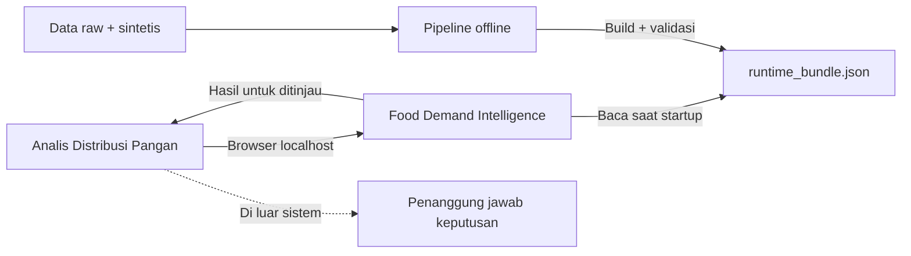
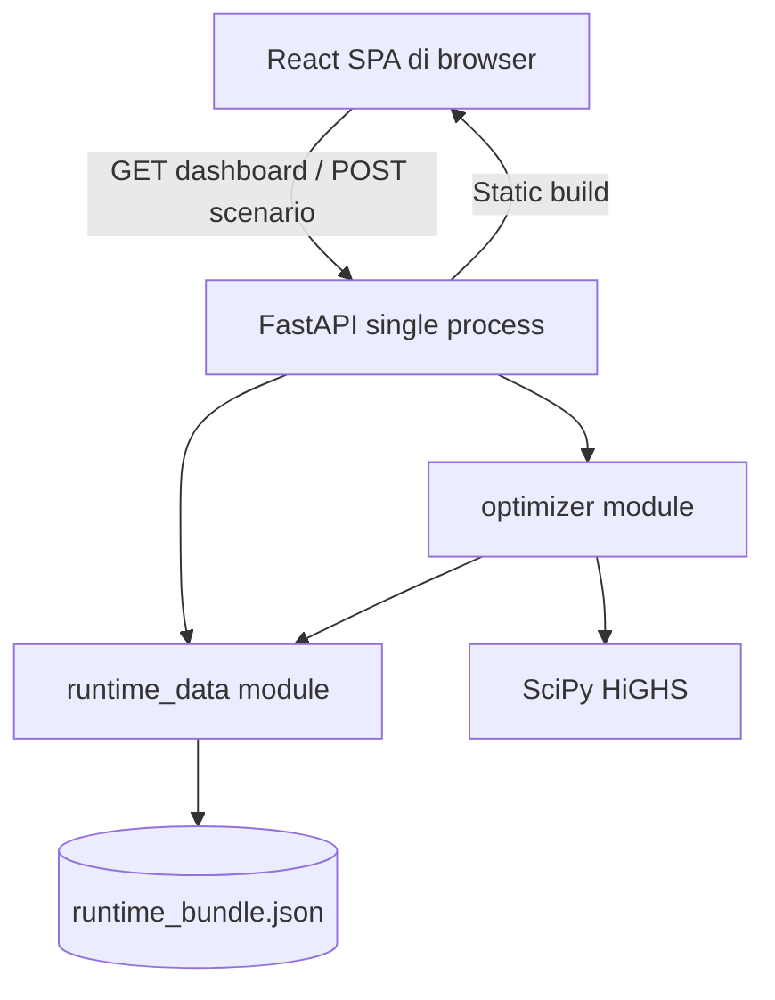
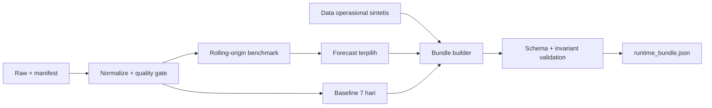

# Software Architecture — Food Demand Intelligence

| Atribut | Nilai |
| --- | --- |
| Status | Siap Ditinjau Tim v0.2 |
| Tanggal | 4 November 2026 |
| Fase | MVP lokal HackDay 24 jam |
| Owner | Zaky Ramadhan |
| Approver | Ismael |
| ADR | `../adr/0001-local-mvp-stack.md` |

## 1. Tujuan dan architecture drivers

Arsitektur harus memenuhi satu alur dashboard responsif, optimizer kurang dari lima detik, runtime offline, startup sederhana, hasil deterministik, serta transparansi data. Scope tidak membutuhkan login, persistensi, multiuser, deployment cloud, atau integrasi data langsung.

Drivers utama:

1. dapat dibangun dan dipulihkan dalam batas HackDay 24 jam;
2. satu proses runtime pada laptop demo;
3. Python tetap menjadi lokasi data science dan optimasi;
4. UI memiliki kontrol responsivitas dan aksesibilitas yang baik;
5. data serta forecast dibekukan dan divalidasi sebelum demo; dan
6. kegagalan artefak atau solver terlihat, tanpa hasil lama yang menyesatkan.

## 2. Keputusan arsitektur

- React + TypeScript + Vite untuk frontend SPA.
- Tailwind CSS untuk layout mobile-first.
- Recharts untuk grafik forecast responsif.
- FastAPI + Pydantic untuk runtime backend dan validasi kontrak.
- SciPy `linprog(method="highs")` untuk optimasi linear.
- Satu `runtime_bundle.json` sebagai penyimpanan runtime read-only.
- Pipeline pandas/scikit-learn/XGBoost berjalan offline sebelum demo.
- FastAPI menyajikan build Vite dan API melalui `127.0.0.1:8000`.
- Tanpa database, Next.js, Supabase, Docker, atau layanan cloud pada MVP.

## 3. System context



Sistem tidak berkomunikasi dengan sumber eksternal saat runtime dan tidak mengeksekusi tindakan distribusi.

## 4. Container/runtime view



Build frontend menghasilkan aset statis. FastAPI menyajikan aset tersebut dan endpoint runtime dari origin yang sama, sehingga MVP tidak memerlukan konfigurasi CORS.

## 5. Offline data flow



Pipeline dan runtime adalah dua jalur berbeda. Kegagalan pipeline tidak boleh terjadi saat pitching karena runtime hanya memakai bundle final yang telah dibekukan.

## 6. Modul dan interface

### 6.1 Frontend module

Interface frontend adalah tiga operasi pengguna: memilih komoditas, mengubah anggaran/kapasitas, dan menjalankan skenario. Frontend bertanggung jawab atas presentasi, validasi cepat, state sementara, loading/error states, responsivitas, dan aksesibilitas. Frontend tidak mengimplementasikan business rules optimizer.

### 6.2 `runtime_data` module

Interface konseptual:

```text
load_bundle() -> RuntimeBundle
get_dashboard(commodity) -> DashboardData
```

Modul menyembunyikan lokasi file, parsing JSON, schema validation, cross-reference, metadata, dan pemilihan data komoditas. Bundle dimuat sekali saat startup dan diperlakukan immutable.

### 6.3 `optimizer` module

Interface konseptual:

```text
optimize(ScenarioInput, RuntimeBundle) -> OptimizationResult
```

Modul menyembunyikan decision variables, matriks, lexicographic solve, HiGHS status, tie-break, post-validation, reason code, dan metrik before/after. Caller tidak perlu mengetahui SciPy.

### 6.4 `api` module

API hanya menerjemahkan HTTP/Pydantic ke `runtime_data` dan `optimizer`. Tidak ada service layer, repository pattern, atau adapter database hipotetis.

Tiga interface HTTP logis:

- health/readiness;
- dashboard data per komoditas; dan
- scenario optimization.

Path dan payload lengkap ditetapkan pada `06_Detailed_Design_API_and_Data_Model.md`.

## 7. Optimizer design

- Decision variable adalah jumlah kg pada kombinasi batch-rute yang valid.
- Variables non-negative dan kontinu; UI membulatkan tampilan, sedangkan validasi constraint memakai presisi penuh.
- HiGHS digunakan melalui SciPy dengan time limit di bawah batas response SRS.
- Prioritas tujuan diselesaikan secara lexicographic/multi-pass: minimalkan defisit, prioritaskan expiry terdekat, lalu minimalkan biaya.
- Setelah solve, backend memvalidasi kembali stok, kapasitas, anggaran, rute, dan defisit sebelum mengembalikan hasil.
- Status solver dipetakan ke `feasible`, `infeasible`, timeout, atau internal error sesuai SRS.
- Hasil nol dibedakan melalui `no_intervention_needed` dan `constraints_block_intervention`.

## 8. Runtime data and storage

`data/runtime/runtime_bundle.json` adalah satu-satunya storage runtime. Bundle memuat metadata, tiga komoditas, forecast, baseline lima wilayah, batch sintetis, rute, biaya, kapasitas, dan parameter default.

Alasan tanpa database:

- tidak ada write/persistensi runtime;
- satu pengguna lokal;
- tidak ada histori, auth, upload, audit, atau workflow; dan
- menghindari migration, seed, koneksi, serta titik kegagalan tambahan.

PostgreSQL baru dipertimbangkan pada pilot ketika penyimpanan skenario, upload, multiuser, audit, atau approval dibutuhkan.

## 9. Repository structure

```text
frontend/          React, TypeScript, Vite, Tailwind, Recharts
backend/           FastAPI, schemas, runtime_data, optimizer
pipeline/          normalize, features, benchmark, bundle builder
data/
  raw/             sumber immutable
  processed/       output pipeline yang dapat dibuat ulang
  runtime/         runtime_bundle.json final
artifacts/         model metrics, config, forecast, report
tests/             backend, pipeline, contract, e2e fixtures
scripts/           build dan launcher demo
docs/adr/          keputusan arsitektur
```

Tidak digunakan monorepo framework atau workspace manager khusus.

## 10. Build and startup

1. Install dependency dari lockfile JavaScript dan Python.
2. Build frontend Vite menjadi aset statis.
3. Launcher memverifikasi frontend build dan `runtime_bundle.json`.
4. FastAPI memuat serta memvalidasi bundle pada startup.
5. Jika validation gagal, proses berhenti dengan pesan yang menunjuk artefak/field bermasalah.
6. Jika valid, aplikasi tersedia pada `http://127.0.0.1:8000`.

Satu script build dan satu script run menjadi interface operasional manusia. Detail perintah ditetapkan pada dokumen deployment.

## 11. Security and privacy

- Bind hanya `127.0.0.1`, bukan `0.0.0.0`.
- Tidak ada auth karena runtime lokal satu pengguna.
- Tidak ada secret, cookie, telemetry, CDN, font eksternal, atau request keluar.
- Semua dependency dan aset harus tersedia sebelum demo.
- Input divalidasi di frontend untuk UX dan di backend sebagai trust boundary.
- Tidak ada path input pengguna, upload, atau evaluasi kode.
- Data pribadi dan data rahasia mitra tidak masuk bundle.

## 12. Reliability and failure modes

| Kegagalan | Respons arsitektur |
| --- | --- |
| Bundle hilang/invalid | Fail-fast saat startup |
| Static build hilang | Launcher menolak start |
| Request invalid | Pydantic/aturan domain mengembalikan error terstruktur |
| Solver timeout | Hapus hasil lama; reason code timeout; retry tersedia |
| Solver infeasible | Tanpa rekomendasi; alasan constraint/solver |
| Frontend kehilangan backend | Banner unavailable; data statis yang sudah ada boleh tetap terlihat |
| Internet putus | Tidak berdampak pada alur utama |

## 13. Performance

- Bundle dimuat sekali, bukan dibaca pada setiap request.
- Dashboard data adalah lookup dan transformasi ringan.
- Model AI tidak dijalankan saat runtime.
- Problem optimizer dibatasi pada lima wilayah, tiga komoditas, dan rute demo.
- Solver memiliki time limit; target end-to-end maksimal lima detik.

## 14. Frontend architecture

- Satu halaman dengan section sesuai urutan PRD.
- State bersifat lokal dan hilang saat refresh.
- Data fetching menggunakan `fetch` bawaan; tidak perlu state/data-fetching framework tambahan.
- Tailwind memakai pendekatan mobile-first mulai viewport 360px.
- Recharts menampilkan forecast dan menyesuaikan container.
- Tabel rekomendasi menjadi kartu atau horizontal scroll pada layar kecil.
- Status selalu memiliki label teks/ikon, bukan warna saja.

## 15. Testing architecture

- `pytest`: quality gate, bundle loader, business rules, optimizer, API contract.
- `Vitest`: formatter, validation, state transition, dan komponen utama.
- `Playwright`: satu alur demo pada Chromium desktop dan viewport mobile.
- Golden fixture: tiga skenario reason code yang disepakati.
- Test memanggil interface modul yang sama dengan runtime; tidak menguji matriks internal secara langsung kecuali diagnosis kegagalan.

## 16. Technology rationale

| Pilihan | Alasan |
| --- | --- |
| React/Vite | Dashboard satu halaman tidak membutuhkan SSR/routing server; build statis kecil |
| FastAPI/Pydantic | Python-native dan validasi kontrak request/response |
| SciPy HiGHS | Solver tersedia dalam stack numerik tanpa ketergantungan CBC eksternal |
| JSON | Sesuai runtime read-only, kecil, dan mudah divalidasi |
| Tailwind | Layout mobile-first dengan build-time CSS |
| Recharts | Grafik React responsif untuk forecast |

## 17. Alternatives rejected for MVP

| Alternatif | Alasan tidak dipilih sekarang |
| --- | --- |
| Next.js + FastAPI | Fitur SSR/server Next tidak dibutuhkan; menambah runtime/integrasi |
| Streamlit | Lebih cepat, tetapi kontrol UI, aksesibilitas, dan presentasi lebih terbatas |
| PostgreSQL/Supabase | Tidak ada requirement persistensi |
| PuLP + CBC | CBC perlu dependency solver terpisah; SciPy HiGHS cukup untuk formulasi MVP |
| Docker | Startup lokal langsung lebih kecil; container tidak memberi kebutuhan produk |

## 18. Evolution path

Tambahkan PostgreSQL hanya setelah persistensi dibutuhkan. Tambahkan auth/RBAC setelah ada pengguna resmi. Pisahkan frontend/backend deployment hanya setelah ada deployment publik. Integrasi data eksternal baru dibuat setelah kontrak dan izin data tersedia. Evolution dilakukan dengan mengganti storage/runtime seam pada saat ada adapter kedua yang nyata, bukan menambah abstraksi sebelum diperlukan.

## 19. Persetujuan

Zaky bertanggung jawab atas arsitektur dan integrasi. Rafa meninjau data/optimizer, Silvana meninjau frontend/accessibility, dan Ismael memberikan persetujuan akhir.

## 20. Referensi teknologi primer

Context7 MCP tidak tersedia pada sesi Codex saat keputusan disusun. Fakta library diperiksa melalui dokumentasi resmi:

- [Vite production build](https://vite.dev/guide/build)
- [FastAPI serving a static frontend](https://fastapi.tiangolo.com/tutorial/frontend/)
- [SciPy linprog with HiGHS](https://docs.scipy.org/doc/scipy/reference/optimize.linprog-highs.html)
- [Tailwind with Vite](https://tailwindcss.com/docs/installation/using-vite)
- [Tailwind responsive design](https://tailwindcss.com/docs/responsive-design)
- [Recharts responsive sizing](https://recharts.github.io/en-US/guide/sizes/)
- [Vitest](https://vitest.dev/guide/)
- [Playwright test runner](https://playwright.dev/docs/running-tests)
- [pytest](https://docs.pytest.org/en/stable/contents.html)
